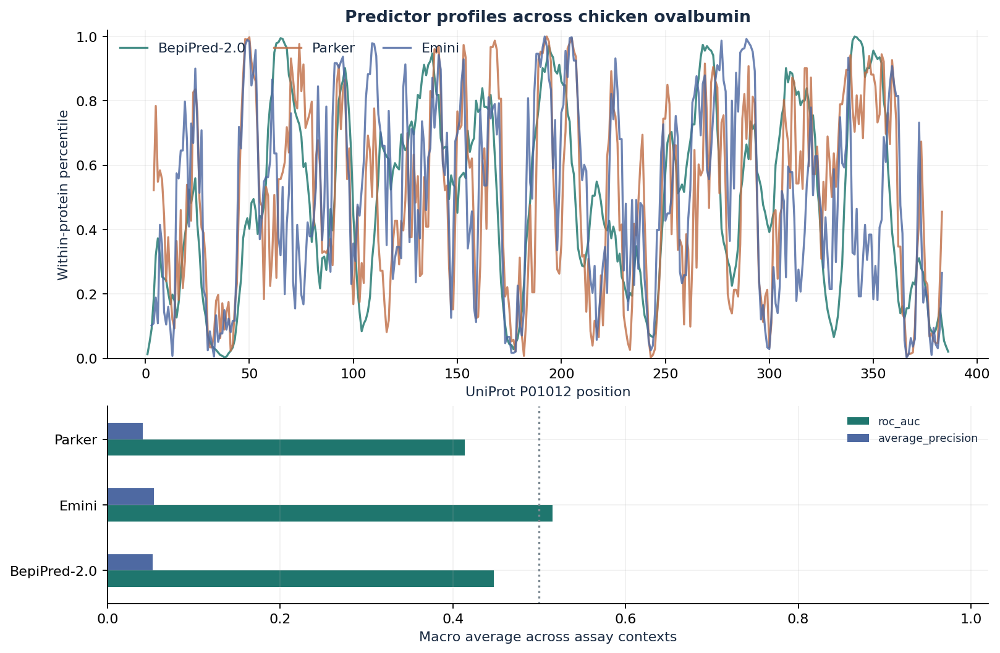

# Ovalbumin B-cell benchmark

**How much do linear epitope predictors agree with published binding assays and with each other?**

Compare BepiPred 2.0, Parker hydrophilicity and Emini surface accessibility on chicken ovalbumin. Benchmarks use linear peptide assays curated by IEDB from three published studies.

## Results

The benchmark retained **381 peptide–assay context pairs**. Two contexts met the minimum of three positives and three negatives. Mean AUROC was **0.516** for Emini, **0.447** for BepiPred 2.0 and **0.414** for Parker. See [context-level metrics](results/metrics.csv), [macro averages](results/macro_average.csv) and the [model agreement table](results/model_agreement.csv).



## Methods

Map exact peptides and retain western blot or microarray binding outcomes. Keep study, method, host and antibody isotype distinct. Collapse identical replicates, omit contradictory context labels and require complete scores from all methods. Average raw residue scores across each assayed peptide and compare AUROC and average precision with assay-specific prevalence. Calculate Spearman agreement for pairs of predictions across shared residue coordinates.

## Reproduce

Use Python 3.12 in this repository.

```powershell
python -m venv .venv
.\.venv\Scripts\python -m pip install -r requirements.txt
.\.venv\Scripts\python analysis.py
.\.venv\Scripts\python -m unittest discover -v
```

On macOS and Linux, use `.venv/bin/python` in place of the Windows executable.
The analysis uses the snapshot included in `data/`.

## Interpretation

IEDB negative labels describe specific assay conditions. This comparison covers linear peptide binding. Peptides overlap heavily, and overlap with BepiPred training data is possible. Interpret the metrics as a retrospective description of two assay contexts.

## Sources and licenses

[IEDB B-cell predictors](https://tools.iedb.org/bcell/) · [BepiPred-2.0 paper](https://doi.org/10.1093/nar/gkx346) · [IEDB Query API](https://query-api.iedb.org/docs/swagger/) · [UniProt P01012](https://www.uniprot.org/uniprotkb/P01012/entry) · [Study 1](https://pubmed.ncbi.nlm.nih.gov/34818647/) · [Study 2](https://pubmed.ncbi.nlm.nih.gov/17236828/) · [Study 3](https://pubmed.ncbi.nlm.nih.gov/14600204/)

Input URLs and hashes are recorded in [data/sources.json](data/sources.json). The MIT license applies to this repository's code. Original datasets, structures and external scores retain their source terms.
